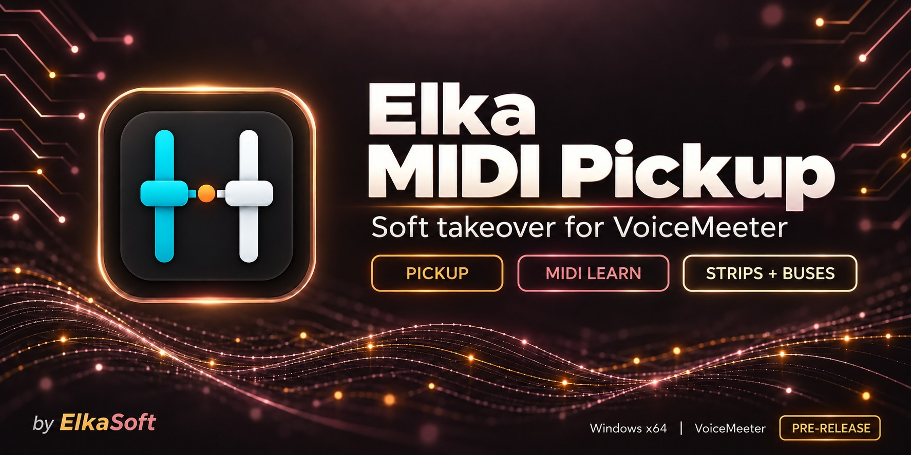

# Elka MIDI Pickup

Soft takeover for ordinary MIDI faders controlling VoiceMeeter. Move a hardware fader to the current software position before it takes control, so mismatched positions do not cause an immediate volume jump.

**Development build: 0.4.0-preview.2 · Windows x64.** Fixes wheel/resize repainting and adds an automatic application list with Use checkboxes, direct input buttons and closed-app cleanup. The existing strip/bus pickup engine is retained. The updated application feature still needs physical controller and listening acceptance.

[Published 0.3.0 prerelease](https://github.com/torment78/Elka.MidiPickup/releases/tag/v0.3.0-preview.1) · [Application MIDI Control beta](docs/Application-MIDI-Control.md) · [Setup and testing](docs/Testing.md) · [Known limitations](docs/Limitations.md) · [Report a problem](https://github.com/torment78/Elka.MidiPickup/issues/new?template=bug_report.md) · [Support on Ko-fi](https://ko-fi.com/msffixit)

The 0.4.0 preview is currently a local/source build; the published 0.3.0 download does not include Application MIDI Control.

## How pickup works

If VoiceMeeter is at -12 dB and the hardware fader is much lower, moving the hardware does nothing to that software gain until it reaches or crosses the target. The fader then tracks normally. Moving that VoiceMeeter gain with the mouse re-arms only the affected hardware fader.

This version reads MIDI input and writes selected gains through the VoiceMeeter Remote API. **Disable the selected faders' duplicate mappings in VoiceMeeter, Bome or other routing software.** Otherwise those routes can bypass pickup.

Elka does not create a virtual MIDI port or forward the controller's other messages. Other controls can remain on existing routes only when your device/driver supports the required sharing. Check this arrangement before moving a full controller setup over.

## Features

- Separate **Application MIDI Control** preview: automatic app rows, Use checkboxes, edition-aware VAIO/AUX/VAIO 3 and In 1–5 pages, MIDI Learn, independent pickup, mute buttons and explicit relative encoder modes. Closed apps leave the list while their learned assignments are retained. [Preview setup and limits](docs/Application-MIDI-Control.md).

- **Sixteen independent mappings** across separate Strips and Buses pages; both pages keep processing together.
- **MIDI Learn** for 7-bit absolute CC faders, with target selection and live hardware/software values.
- **Pickup direction and tolerance** of 0–3 MIDI steps; new setups default to three.
- **Gain range** from -60 dB to a selectable 0, +6 or +12 dB maximum, with a linear dB mapping.
- **Tray operation**, optional launch with Windows, launch in tray and active startup using the last saved setup.
- **VoiceMeeter Potato button 2** to show/hide the app on supported versions, leaving button 1 available for FX Host.
- **Disconnected demo mode** to try pickup without touching live audio.
- **Dark desktop UI**, a dedicated app/tray icon, diagnostic counters and a local troubleshooting log.
- Native **C++20 / Win32**, with no .NET runtime requirement.

## Download and first setup

1. Download **Elka.MidiPickup-0.3.0-preview.1-win-x64-unsigned.zip** from the prerelease page.
2. Extract the ZIP into a writable folder and run **Elka.MidiPickup.exe**. The EXE is unsigned; the download includes SHA-256 checksums. This preview has no installer.
3. Start VoiceMeeter, select your **MIDI device**, click **Connect MIDI**, then **Connect VM**.
4. Pick a row under **Strips** or **Buses**, click **Learn**, move one hardware fader, and choose its target.
5. Disable that selected fader's other direct mappings, tick the confirmation, and click **Start pickup**.
6. Test one fader, including fast reversals and a software gain change, then **Save setup**.

Start with a comfortable listening level. First launch stays in monitor mode until you explicitly start pickup. Settings and logs are stored beside the EXE, so do not run it inside the ZIP or a protected installation folder.

The app discovers VoiceMeeter's installed `VoicemeeterRemote64.dll` in the standard `Program Files (x86)\VB\Voicemeeter` location. VoiceMeeter must be installed and running for live control. No VoiceMeeter DLL, Microsoft MIDI preview runtime, or virtual MIDI driver is included.

## Tray and startup

Under **Settings**, choose **Launch with Windows**, **Launch in tray** and/or **Launch active**, then **Save setup**. Windows startup uses that exact executable path. Active startup waits for the saved MIDI device and VoiceMeeter, reads fresh gains, and arms pickup; it never restores a previously acquired fader position.

**Hide** or the window X leaves the app running in the tray. Open it from the tray, the supported VoiceMeeter button, or by launching the EXE again. **Exit** stops the app and removes its VoiceMeeter button. Allow about 1.5 seconds for shutdown.

Before moving or deleting the app, turn off **Launch with Windows** and save. To update, exit the running copy, preserve `Elka.MidiPickup.ini`, then replace the EXE in the same folder. Release packages contain no personal settings.

## Testing status

The 0.4.0 preview passes **43,107 regression checks per configuration** in Debug and Release x64. These cover the original pickup engine, delayed readbacks, reversals, external edits, concurrent MIDI buffering, profiles and the new application actions/identity rules. Separate integration checks passed against a silent test-owned Windows audio session, including the complete Learn/Start/pickup/mute/Stop flow and source-conflict recovery. They do not replace physical MIDI/audio testing.

The earlier 0.2.1 engine was reported working with an APC40 mkII and VoiceMeeter Potato. The latest custom-button cleanup, Windows sign-in launch, unattended active startup and broader hardware/edition compatibility remain acceptance tests. See the [testing checklist](docs/Testing.md) and [release notes](docs/releases/0.3.0-preview.1.md).

## Build in Visual Studio 2026

Open **Elka.MidiPickup.sln**, select **Release | x64** or **Debug | x64**, and set **Elka.MidiPickup.App** as the startup project. Install the C++ desktop workload with **v145** and Windows SDK **10.0.26100.0**.

```powershell
.\scripts\Build.ps1 -Configuration Release
.\artifacts\x64\Release\Elka.MidiPickup.Tests.exe
```

The default build contains the app and tests, with no package download. The optional compatibility probe is excluded from the default solution build. Build it explicitly with `-IncludeProbe` when needed; it uses PowerShell 7 to download and verify a project-local Microsoft MIDI preview SDK. The probe and its preview binaries are not part of the portable release.

See [development notes](docs/Development.md) for the source layout and packaging command.

## Artwork and support

[Horizontal JPEG](docs/images/midi-pickup-horizontal-under-1mb.jpg) · [Vertical JPEG](docs/images/midi-pickup-vertical-under-1mb.jpg) · [PNG masters and sizes](docs/Artwork.md) · [App icon](app/Assets/README.md)

The warm amber and rose headers follow the ElkaSoft audio-app family. Both JPEG versions are below 1 MB.

If the app helps your setup, you can [support ElkaSoft on Ko-fi](https://ko-fi.com/msffixit). For a problem report, include the app version, MIDI device, VoiceMeeter edition/version, target, tolerance and the bottom status message. Review any log before attaching it.

VoiceMeeter is a VB-Audio product. Elka MIDI Pickup is an independent ElkaSoft utility.
